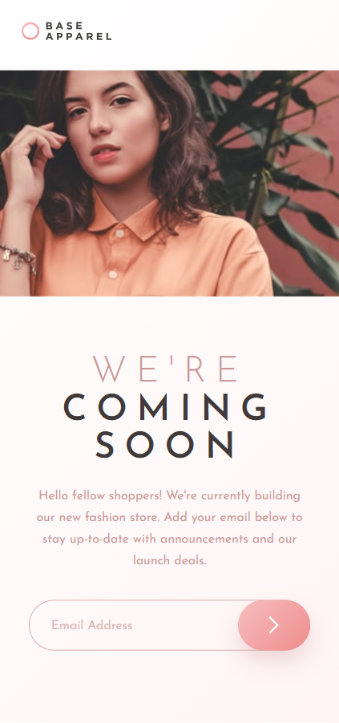
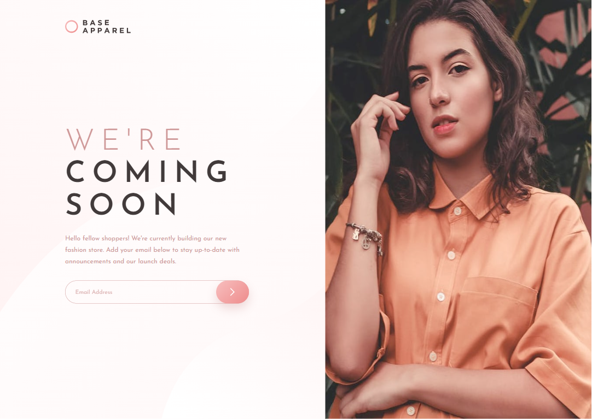

# Frontend Mentor - Base Apparel Coming Soon Page

This is my solution to the [Base Apparel Coming Soon Page challenge](https://www.frontendmentor.io/challenges/base-apparel-coming-soon-page-5d46b47f8db8a7063f9331a0) on Frontend Mentor. This project helped me practise responsive web design, CSS layouts, and JavaScript form validation.

## Table of Contents

- [Overview](#overview)
  - [The Challenge](#the-challenge)
  - [Screenshot](#screenshot)
  - [Links](#links)
- [My Process](#my-process)
  - [Built With](#built-with)
  - [What I Learned](#what-i-learned)
  - [Continued Development](#continued-development)
  - [Useful Resources](#useful-resources)
  - [AI Collaboration](#ai-collaboration)
- [Author](#author)

## Overview

### The Challenge

Users should be able to:

- View a responsive layout on mobile and desktop devices.
- See hover and focus states for interactive elements.
- Receive an error message when submitting an empty or incorrectly formatted email address.

### Screenshot

### Links

- **Github Repo URL:** [Github Repo URL](https://github.com/stephany247/base-apparel-coming-soon-master)
- **Live Site URL:** [Live Demo](https://stephany247.github.io/base-apparel-coming-soon-master/).

## My Process

### Built With

- Semantic HTML5
- CSS custom properties
- CSS Grid and Flexbox
- Mobile-first workflow
- Responsive media queries
- JavaScript form validation
- Google Fonts — Josefin Sans

### What I Learned

I improved my understanding of responsive layouts by combining CSS Grid and Flexbox to create separate mobile and desktop experiences.

I also practised JavaScript form validation, including displaying error messages and updating the input's error state.

One important lesson was understanding how padding, positioning, and element height affect the overall desktop layout.

### Continued Development

I want to continue improving my skills in:

- Responsive layouts across different screen sizes.
- Writing maintainable CSS.
- Accessible form validation and error feedback.
- Debugging layout and positioning issues.
- Building interactive interfaces with JavaScript.

### Useful Resources

- [MDN Web Docs — CSS Grid](https://developer.mozilla.org/en-US/docs/Web/CSS/CSS_grid_layout) — Understanding grid-based layouts.
- [MDN Web Docs — Flexbox](https://developer.mozilla.org/en-US/docs/Web/CSS/CSS_flexible_box_layout) — Aligning and arranging elements.
- [MDN Web Docs — Constraint validation](https://developer.mozilla.org/en-US/docs/Web/HTML/Constraint_validation) — Understanding HTML form validation.
- [Frontend Mentor](https://www.frontendmentor.io/) — Practising frontend development with realistic challenges.

### AI Collaboration

I used ChatGPT to discuss layout issues, review CSS approaches, and troubleshoot responsive spacing. This helped me explore different solutions and better understand how layout properties affect the final design.

## Author

- **Frontend Mentor:** [@stephany247](https://www.frontendmentor.io/profile/stephany247)
- **GitHub:** [Github ProfileURL](https://github.com/stephany247)
